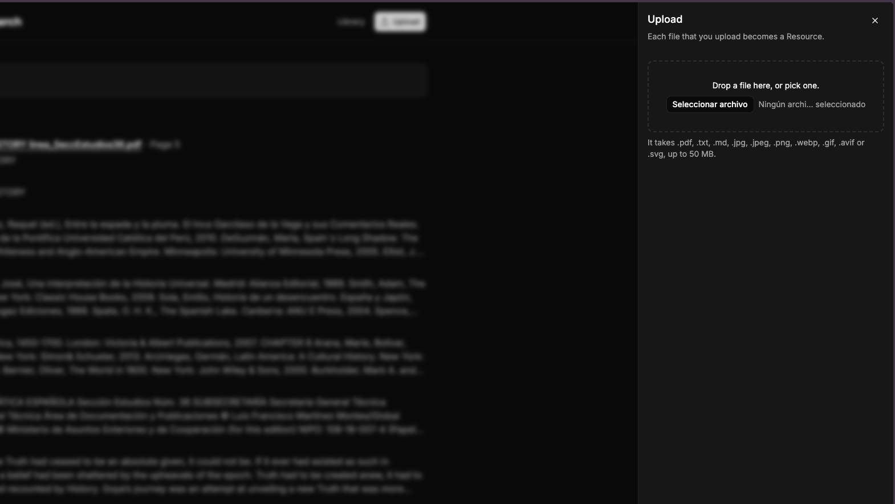
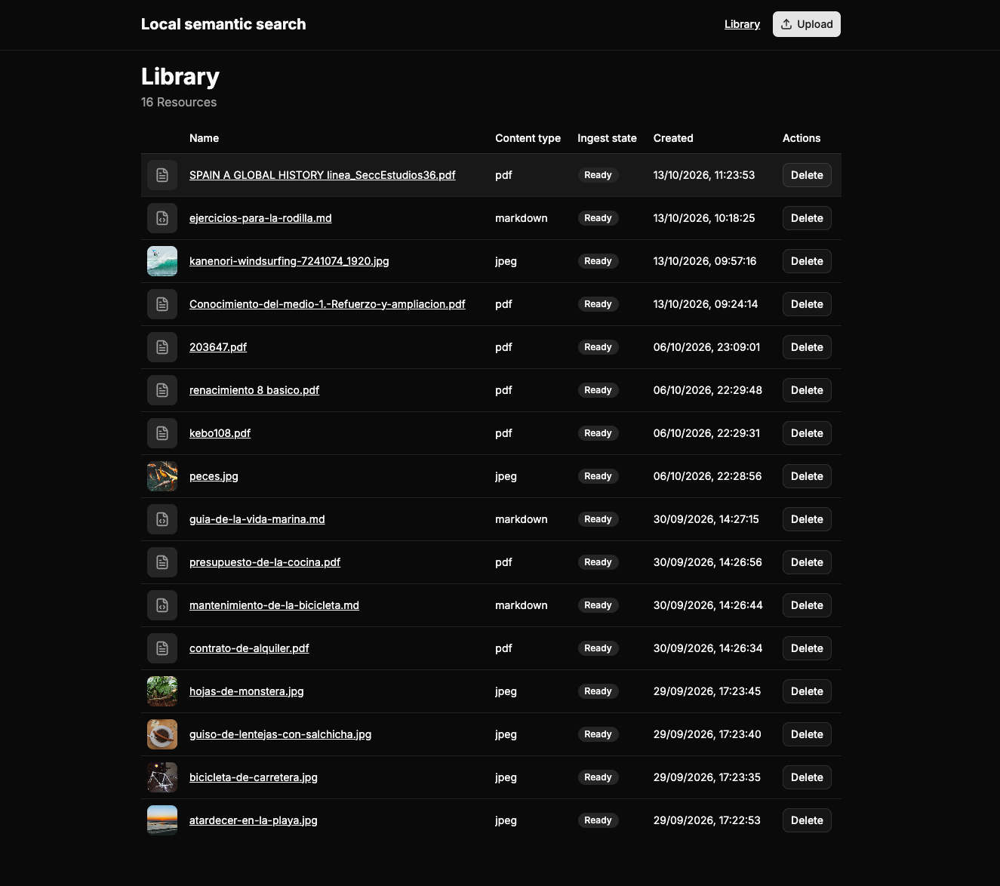
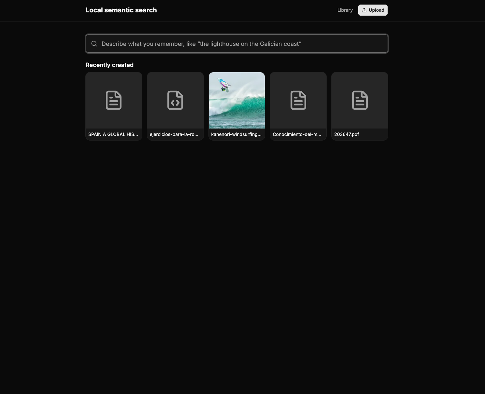
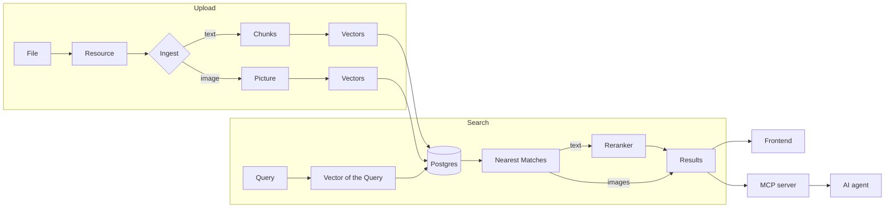

# Local semantic search

A local product that finds your own content by meaning. You upload your files: PDF,
plain text, Markdown and images. Then you type what you remember, in your own words,
and the product shows the files and the passages that match. The words of your text
do not have to be the words of the file.

All the work runs on your machine. The models run locally, and your files never go
to a cloud service.

The project started as a proof of concept of semantic search. It is now the
retrieval part of a RAG system: an AI agent connects to it through MCP, gets the
passages that match a question, and writes the answer from them.

## What you can do with it

- **A local knowledge center.** Keep your PDFs, notes and Markdown in one place, and
  find a passage when you do not remember the exact words.
- **A memory for an AI agent.** Claude Code, Cursor or another agent reads the
  documentation of a project, a specification or the minutes of a meeting through
  MCP, and answers with that information. This is the full RAG case.
- **Find images by a description.** Type "a sunset on the beach" or "a diagram with
  arrows", and the images that look like that come back. The image does not need a
  name or a tag.
- **Search across languages.** Type in Spanish and find a document in English. The
  text model is multilingual.
- **Keep private content private.** The product needs the network only one time, to
  get the models. After that, it works offline.

## How you use it

**1. Upload a file.** Each file that you upload becomes a Resource.



**2. Wait until it is Ready.** The Library lists each Resource with its Ingest state.
`Ingesting` changes to `Ready` when the Resource can be found, or to `Failed` with a
reason.



**3. Type what you remember.** The search page shows text Results and image Results
in two groups. Each text Result shows the passage that matched and its page.



## How it works



A model can turn a text or an image into a list of numbers, a **Vector**. Two texts
with a similar meaning get Vectors that are near each other, also when they use
different words. The product uses this to find content by meaning.

1. **Upload.** You give a File, and the product creates a **Resource**: the record of
   the File and its stored copy.
2. **Ingest.** The product reads the File. It cuts a text into **Chunks**, which are
   short passages that keep the page they come from. An image stays whole, as one
   **Picture**. A model calculates the Vector of each Chunk and each Picture, and the
   product stores them in Postgres.
3. **Query.** You type a text. The same models calculate its Vectors.
4. **Search.** Postgres finds the Chunks and the Pictures whose Vectors are nearest
   to the Vectors of the Query. These are the **Matches**.
5. **Rerank.** A third model, the **Reranker**, reads the Query and each text Match
   together and gives a better score. In each group, the product removes the
   Matches with a low score and orders the rest.
6. **Results.** The product groups the Matches by Resource. A **Result** is one
   Resource with the Matches that found it. The frontend shows the Results, and the
   MCP server gives them to an agent.

The product uses three models. A text model embeds the Chunks. A vision model embeds
the Pictures and lets a text find an image. The Reranker orders the text Results. All
the words in bold are in the glossary, [`CONTEXT.md`](CONTEXT.md).

## What it does not do

- It does not write answers. It finds the content, and the agent that you connect
  writes the answer.
- It does not include an agent. You connect your own agent through MCP.
- It has no users, no accounts and no authentication. It runs for one person on one
  machine.
- It does not use the network after it gets the models.

## The applications

The repository is a pnpm workspace with four packages. Each package has its own
README.

| Package | What it is |
|---|---|
| [`backend/`](backend/README.md) | The HTTP API. It stores the Resources, runs the Ingest and the Search, and holds the models. |
| [`frontend/`](frontend/README.md) | The web interface: search, Library and Upload. |
| [`mcp/`](mcp/README.md) | The MCP server. It lets an AI agent search your Resources. |
| [`contract/`](contract/README.md) | The TypeScript types of the HTTP API, which the other three packages read. |

## Prerequisites

- **Node 24.** The repository holds an `.nvmrc`, so `nvm use` selects it.
- **pnpm.** The version is pinned in `package.json`. Run `corepack enable pnpm` one
  time, and Node gets that version for you.
- **Docker.** It runs Postgres, and nothing else. The applications run natively.
- **Disk and memory.** The first start downloads about 2.3 GB of models. The backend
  keeps about 4 GB in memory while it runs.

## Quick start

Three commands on a clean clone:

```sh
pnpm install
pnpm run bootstrap
pnpm dev
```

- `pnpm install` installs the four packages.
- `pnpm run bootstrap` writes the `.env` files of the backend and of the MCP server,
  starts Postgres, applies the migrations and downloads the models.
- `pnpm dev` starts the backend on `http://localhost:3001` and the frontend on
  `http://localhost:5173`.

Open `http://localhost:5173` and upload a file. To connect an agent, read
[`mcp/README.md`](mcp/README.md).

## The scripts

These scripts run from the root of the repository.

| Command | What it does |
|---|---|
| `pnpm run bootstrap` | Starts the store, applies the migrations and gets the models |
| `pnpm run models:fetch` | Gets the weights of the models into the model store |
| `pnpm dev` | Starts the backend and the frontend together |
| `pnpm run lint` | Runs Biome over the whole tree |
| `pnpm run lint:ci` | Runs Biome the way CI runs it, and writes nothing |
| `pnpm run format` | Runs Biome and writes the fixes |
| `pnpm run typecheck` | Runs `tsc --noEmit` in each package |
| `pnpm run test:unit` | Runs the unit tests |
| `pnpm run test:integration` | Runs the integration tests |
| `pnpm run test:e2e` | Runs the end-to-end tests |
| `pnpm run test:eval` | Runs the evals |

## The tests

Vitest runs in four modes, and each mode has one script.

| Mode | What it covers | What it needs |
|---|---|---|
| `unit` | The domain and the use cases, with the ports mocked | Nothing |
| `integration` | The adapters that talk to the store, the disk or the backend | Docker, for the backend |
| `e2e` | The endpoints of the backend, over the application booted in process | Docker |
| `eval` | How good a Search is, as a score | Docker and the models |

CI runs Biome, the type check and the unit tests. The README of each package tells
how its tests run, and [`docs/contributing.md`](docs/contributing.md) gives the rules
for writing them.

## How the decisions were made

Two places record why the project is the way it is.

- [`CONTEXT.md`](CONTEXT.md) is the glossary of the domain. The code, the interface
  and the documentation use its words, and each word has one meaning.
- [`docs/adr/`](docs/adr/) holds the Architecture Decision Records. Each ADR records
  one decision of design, taken during the development, with its context and the
  options that were not chosen. Some ADRs are conventions: how to write each kind of
  class or file, such as a use case, a controller or a gateway.

When you ask "why is this so?", an ADR probably gives the answer. Before you change
the code of a package, read its conventions.

## More documentation

- [`docs/contributing.md`](docs/contributing.md): the house style, what CI runs, and
  the rules of the tests.
- [`docs/evals-glossary.md`](docs/evals-glossary.md): the words of the evals, such as
  F0.5, `holdout` and the verdict, for a person who is new to search and RAG.
